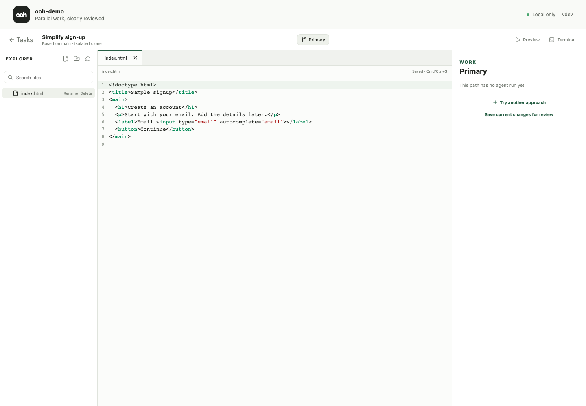

# Ooh

A local Git workspace for comparing coding-agent approaches. Give each approach
an isolated clone, freeze the result into a checkpoint, and review summaries and
diffs before preparing one commit for your base branch.

**Early alpha.** Build from source; there are no published releases yet.
Try it on repositories you can recover.



Actual local dashboard, using a synthetic sample repository and a manually
prepared checkpoint. No coding agent was run to create this example.

- Launch installed Codex or Claude Code CLIs in separate workspaces.
- Review immutable checkpoints with summaries, verification notes, and file diffs.
- Preview an isolated integration commit before applying it; undo is available
  while that commit remains the clean base tip.

## Build and try it

Requires Go 1.26+, Node.js 24+, pnpm 10, and Git 2.31+.

```sh
git clone https://github.com/keyanfayaz/git-ooh.git
cd git-ooh
pnpm --dir web install
make build
./bin/ooh version
```

Run the resulting `bin/ooh` binary inside a Git repository with at least one
commit. Its loopback dashboard opens in your browser. Choose **New task** to
configure the approaches, agents, and models.

Ooh uses the agents' existing local authentication. Ooh itself does not call a
hosted model API; the agents you launch use their own providers and permissions.

## How work stays reviewable

Each approach has a separate clone. Checkpoints preserve its work, and integration
prepares an exact diff before changing the base branch. The dashboard binds to
`127.0.0.1` and authenticates API requests with a local session token.

The [full guide](GUIDE.md) covers the CLI, agent setup, retention, integration,
undo, and privacy limits. See [architecture](docs/architecture.md),
[security reporting](SECURITY.md), and [contributing](CONTRIBUTING.md).

Inspired by [GitButler](https://gitbutler.com) and
[Difit](https://github.com/yoshiko-pg/difit). [MIT license](LICENSE).
